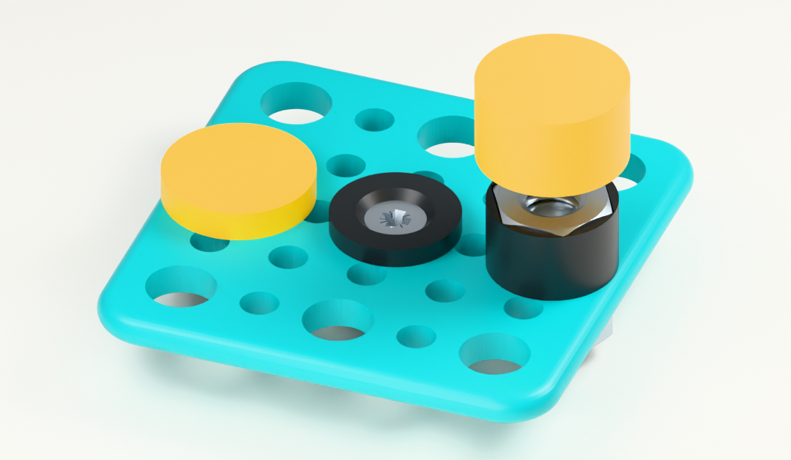
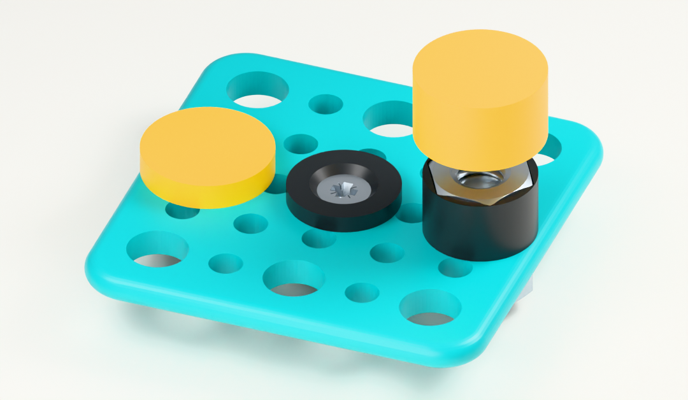
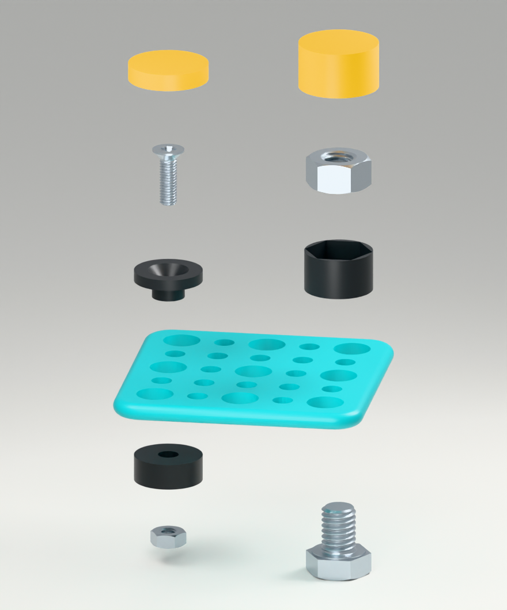
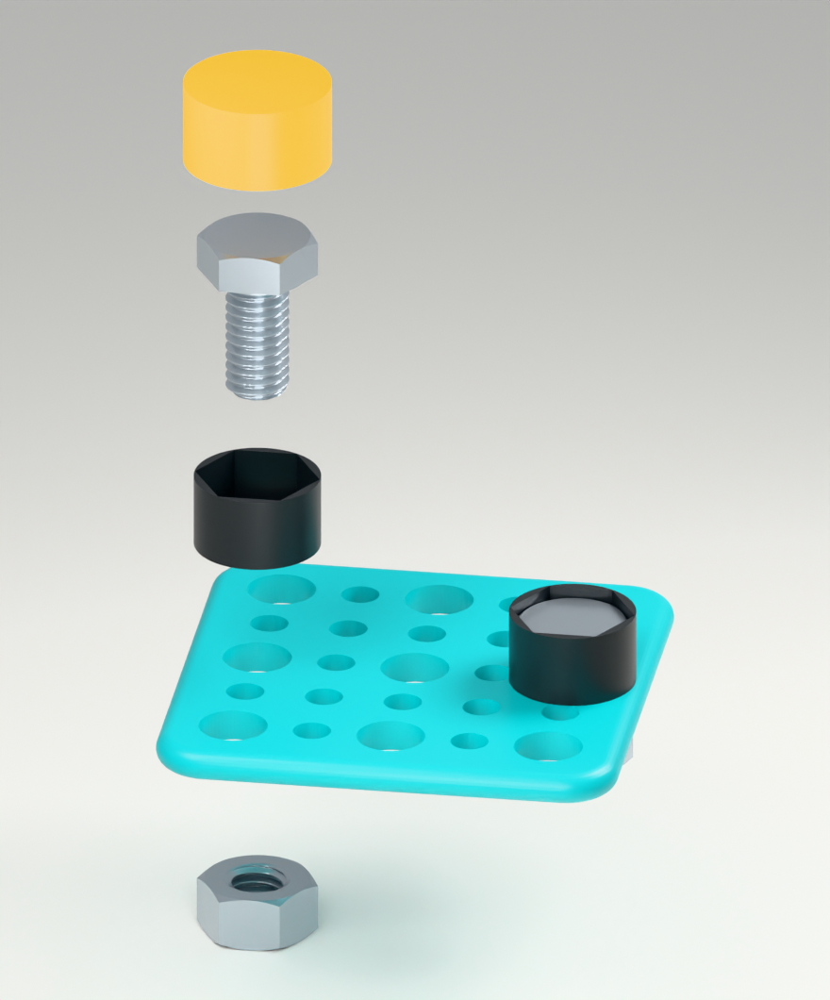

# OOBB cosmetic nut and screw adapters (Version 5)

These printable adapters seat a countersunk screw, wood screw or hex nut on an OOBB part. A plain 14 mm cap covers the fastener and follows the width of a single OOBB strip.

Project repository: [oomlout_oobb_part_cosmetic_nut_screw_adapter_version_5](https://github.com/oomlout/oomlout_oobb_part_cosmetic_nut_screw_adapter_version_5).

Adapted from [Oomlout’s original hardware screw and nut adapters](https://github.com/oomlout/oomlout_oobb_hardware_screw_nut_adapter).

This is an entirely AI-generated coding project. The source is largely unreadable by humans. Usable generated files are included so others can use their own AI tools to modify and regenerate the design.

AI-generated CAD images and instructions. Errors possible. Physical fit has not been tested.

## Choose a print set

Each editable Bambu Studio project contains five of each of the four adapters and five matching caps per style. Both use the default P1S 0.4 mm profile and black filament in slot 1. The illustrations use colour to distinguish the parts.

| Mounting | When to use it | Files |
| --- | --- | --- |
| [](output/basic_set_to_flat/) **[To flat](output/basic_set_to_flat/)** | A flat underside bears directly on the mounting surface. Centre the adapter by hand before tightening the fastener. | [P1S plate](output/basic_set_to_flat/working.3mf) · [Illustrated guide](output/basic_set_to_flat/#assembly) · [Offline HTML](output/basic_set_to_flat/assembly/assembly_instructions.html) · [PDF](output/basic_set_to_flat/assembly/assembly_instructions.pdf) |
| [](output/basic_set_to_m6/) **[To M6](output/basic_set_to_m6/)** | A 5.75 mm locating sleeve enters an M6 clearance hole. It projects 3 mm on the two screw adapters and 1.5 mm on the M3 nut adapter. The M6 nut adapter has a flat underside because its 6.5 mm bore is wider than the sleeve. | [P1S plate](output/basic_set_to_m6/working.3mf) · [Illustrated guide](output/basic_set_to_m6/#assembly) · [Offline HTML](output/basic_set_to_m6/assembly/assembly_instructions.html) · [PDF](output/basic_set_to_m6/assembly/assembly_instructions.pdf) |

## Assembly

1. Choose the fastener and mounting version. Centre the flat flange over the hole, or insert the M6 locating sleeve.
2. Seat the fastener. For a nut, align its flats and insert the mating screw from the reverse side. For a wood screw, provide a timber backing.
3. Tighten the joint and check the exposed height. Press the matching cap over the flange.



The left joint uses an M3 countersunk screw and a [flat M3 nut adapter](parts/oobb_part_cosmetic_adapter_m3_nut_12_mm_diameter_4_5_mm_depth_to_flat/) on the back of the plate. The right joint captures the M6 nut.

### Using the M6 nut adapter for a bolt head

The same M6 nut adapter also captures an M6 hex-head bolt with a 10 mm head across the flats. Feed the shank through the pocket and plate, align the head flats and seat the head. Tighten an M6 nut on the reverse side and press the cap over the bolt head.



[Browse individual printable parts by taxonomy](navigation_oobb/oobb/part/cosmetic/) · [Full-detail CAD sources](source_file/README.md)

## Regeneration

Install Python 3.10 or newer, OpenSCAD and Blender 5.2. Put both applications on PATH. From the project folder run:

```powershell
python -m pip install -r requirements.txt
python action_make_all.py
```

On Windows, `.\make_all.bat` runs the same build. Edit the dimensions and assembly text in [working_oomp_populate.py](working_oomp_populate.py). The P1S template, hardware meshes and plate geometry are included for offline regeneration.
