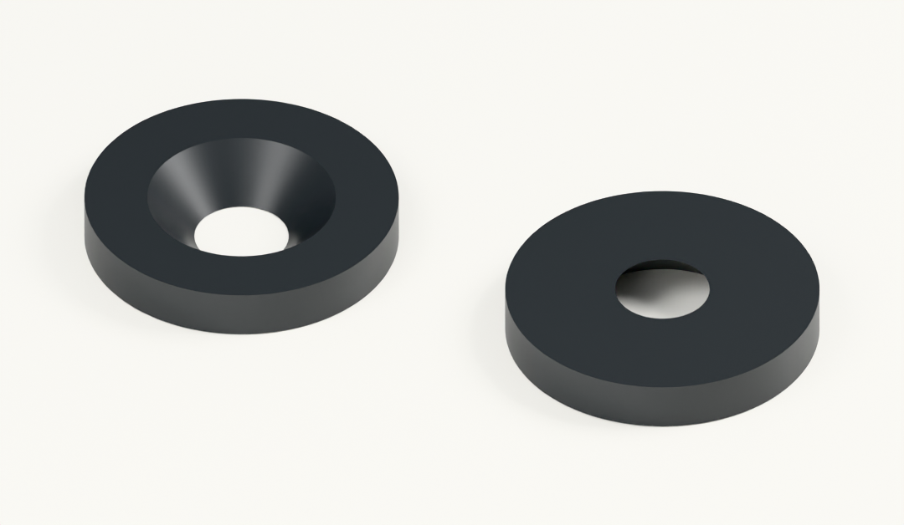
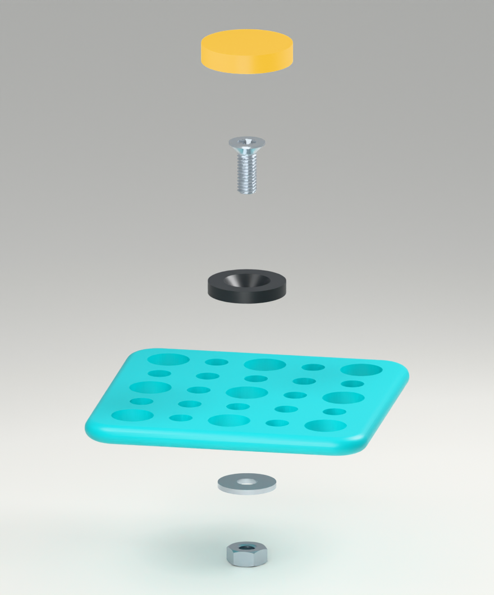

# M3 countersunk screw adapter · To flat

Outside diameter **12 mm** · overall height **1.9 mm**.

[Print this adapter](3dpr.stl) · [Matching cap](../../../../../../../../../../parts/oobb_part_cosmetic_cap_m3_countersunk_14_mm_diameter_2_9_mm_depth_to_flat/) · [40-piece print set](../../../../../../../../../../output/basic_set_to_flat/working.3mf)

## Assembly

1. Choose the adapter and cap for the same fastener. Check the screw length against the plate, adapter and available thread or backing.
2. Centre the flat underside of the adapter over the hole, with the fastener pocket facing out.
3. Pass the countersunk screw through the conical seat. Back the plate’s clearance hole with a wide M3 washer and nut. Tighten until the head sits below the rim.
4. Check that the fastener clears the underside of the cap roof. Press the cap over the flange with its open end toward the plate.

The black flange rests on the teal plate. The yellow cap covers the exposed flange. The same fastener takes the same cap in either mounting version.

[Hardware record](https://github.com/oomlout/oomp_hardware_screw_version_5/tree/main/parts/hardware_screw_countersunk_pozidriv_bright_zinc_plated_m3_diameter_8_mm_length) · [Set guide](../../../../../../../../../../output/basic_set_to_flat/) · [Canonical part](../../../../../../../../../../parts/oobb_part_cosmetic_adapter_m3_countersunk_12_mm_diameter_1_9_mm_depth_to_flat/)

AI-generated CAD images and instructions. Errors possible. Physical fit has not been tested.

OOMP ID `oobb_part_cosmetic_adapter_m3_countersunk_12_mm_diameter_1_9_mm_depth_to_flat`
