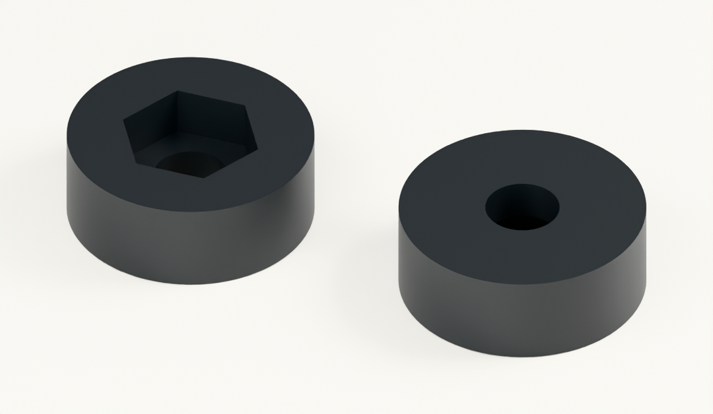
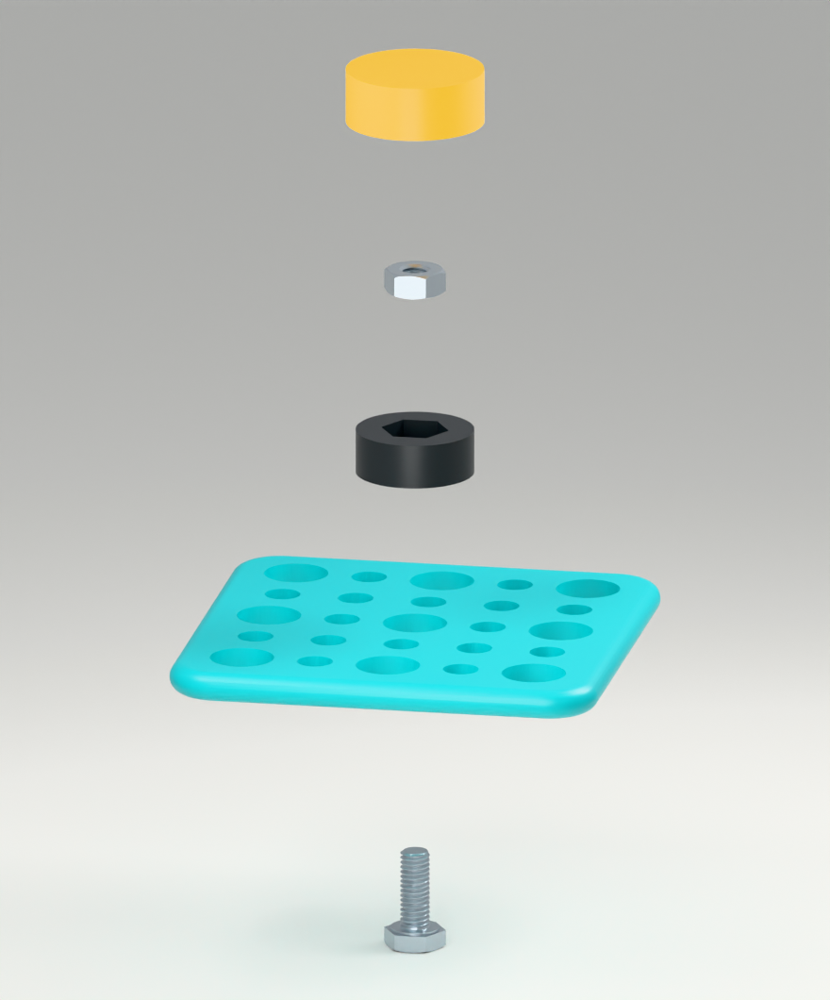

# M3 hex nut adapter · To flat

Outside diameter **12 mm** · overall height **4.5 mm**.

[Print this adapter](3dpr.stl) · [Matching cap](../../../../../../../../../../parts/oobb_part_cosmetic_cap_m3_nut_14_mm_diameter_5_5_mm_depth_to_flat/) · [40-piece print set](../../../../../../../../../../output/basic_set_to_flat/working.3mf)

## Assembly

1. Choose the adapter and cap for the same fastener. Check the screw length against the plate, adapter and available thread or backing.
2. Centre the flat underside of the adapter over the hole, with the fastener pocket facing out.
3. Align the M3 nut with the hex pocket and seat it against the floor. Insert the M3 screw from the other face of the plate and tighten. If you cap the nut side, check the screw tip clears the roof.
4. Check that the fastener clears the underside of the cap roof. Press the cap over the flange with its open end toward the plate.

The black flange rests on the teal plate. The yellow cap covers the exposed flange. The same fastener takes the same cap in either mounting version.

[Hardware record](https://github.com/oomlout/oomp_hardware_bolt_version_5/tree/main/parts/hardware_nut_m3) · [Set guide](../../../../../../../../../../output/basic_set_to_flat/) · [Canonical part](../../../../../../../../../../parts/oobb_part_cosmetic_adapter_m3_nut_12_mm_diameter_4_5_mm_depth_to_flat/)

AI-generated CAD images and instructions. Errors possible. Physical fit has not been tested.

OOMP ID `oobb_part_cosmetic_adapter_m3_nut_12_mm_diameter_4_5_mm_depth_to_flat`
