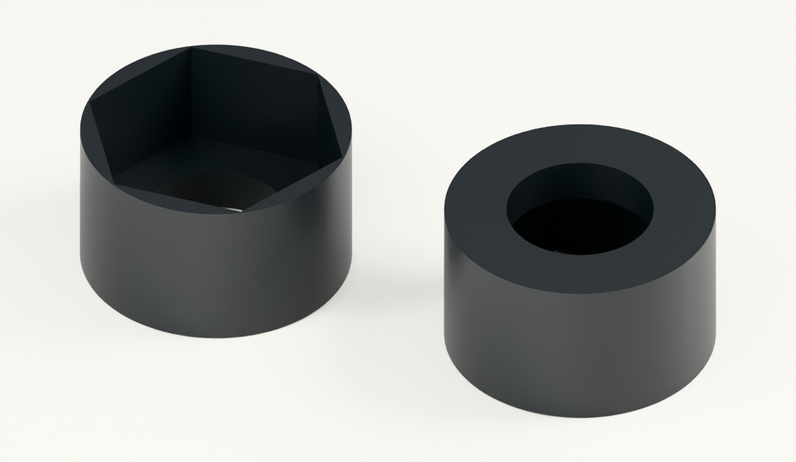
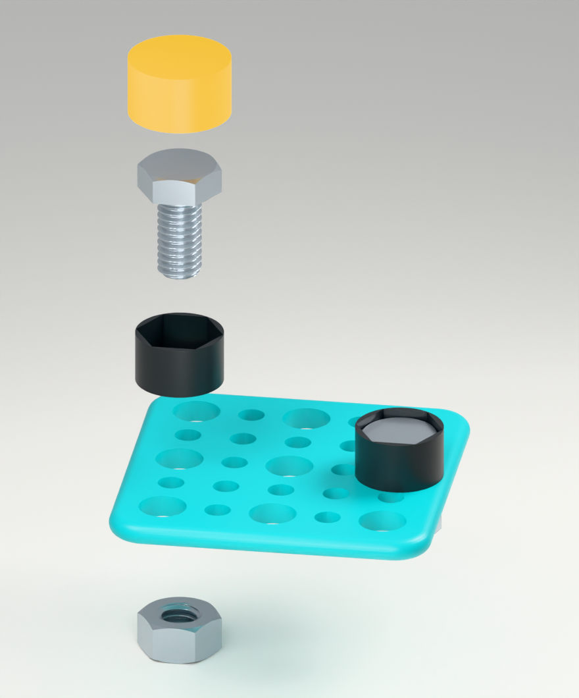
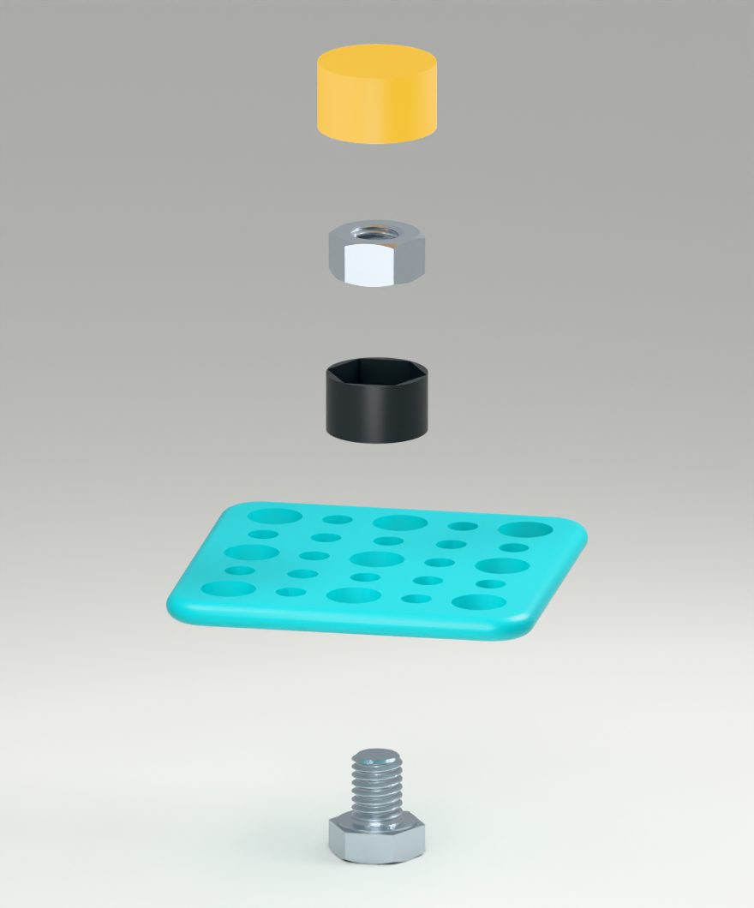

# M6 hex nut adapter · To M6

Outside diameter **12 mm** · overall height **7 mm**.

[Print this adapter](3dpr.stl) · [Matching cap](../../../../../../../../../../parts/oobb_part_cosmetic_cap_m6_nut_14_mm_diameter_8_mm_depth_to_m6/) · [40-piece print set](../../../../../../../../../../output/basic_set_to_m6/working.3mf)

## Assembly

1. Choose the adapter and cap for the same fastener. Check the screw length against the plate, adapter and available thread or backing.
2. Centre the adapter over the M6 clearance hole. On this nut seat the 6.5 mm through-bore leaves a flat underside.
3. Seat the hex nut in the pocket and thread an M6 screw in from below. The pocket is 5 mm deep. The 5.2 mm example nut stands 0.2 mm proud and lifts the cap by that amount.
4. Check that the fastener clears the underside of the cap roof. Press the cap over the flange with its open end toward the plate.

## Using an M6 hex-head bolt

The same M6 nut adapter also captures an M6 hex-head bolt with a 10 mm head across the flats. Feed the shank through the pocket and plate, align the head flats and seat the head. Tighten an M6 nut on the reverse side and press the cap over the bolt head.

The black flange rests on the teal plate. The yellow cap covers the exposed flange. The same fastener takes the same cap in either mounting version.

[Hardware record](https://github.com/oomlout/oomp_hardware_bolt_version_5/tree/main/parts/hardware_nut_m6) · [Set guide](../../../../../../../../../../output/basic_set_to_m6/) · [Canonical part](../../../../../../../../../../parts/oobb_part_cosmetic_adapter_m6_nut_12_mm_diameter_7_mm_depth_to_m6/)

AI-generated CAD images and instructions. Errors possible. Physical fit has not been tested.

OOMP ID `oobb_part_cosmetic_adapter_m6_nut_12_mm_diameter_7_mm_depth_to_m6`
