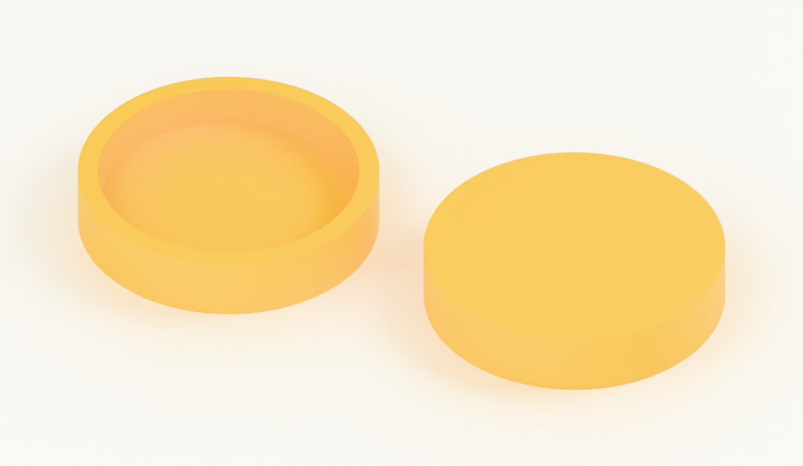
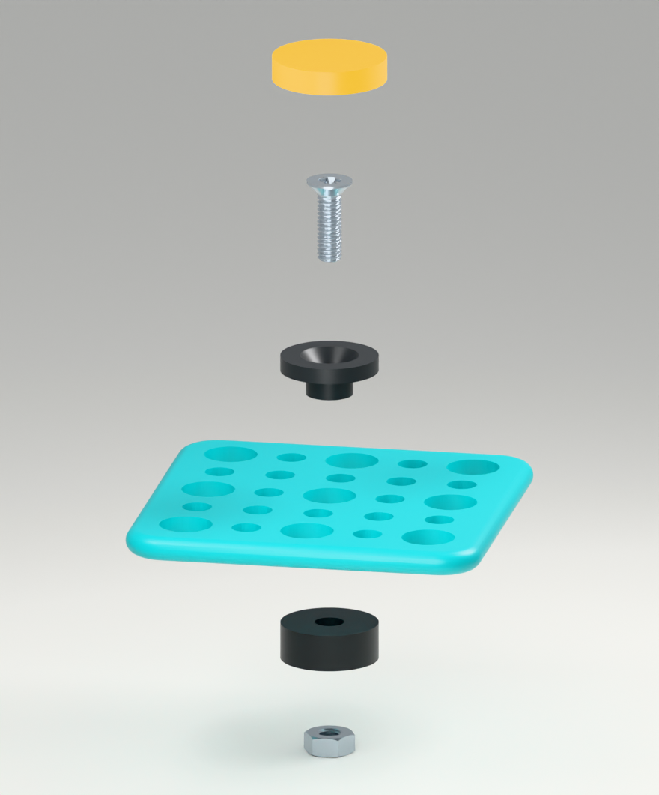

# M3 countersunk screw cap · To M6

Outside diameter **14 mm** · overall height **2.9 mm**.

[Print this cap](3dpr.stl) · [Matching adapter](../../../../../../../../../../parts/oobb_part_cosmetic_adapter_m3_countersunk_12_mm_diameter_4_9_mm_depth_to_m6/) · [40-piece print set](../../../../../../../../../../output/basic_set_to_m6/working.3mf)

## Assembly

1. Choose the adapter and cap for the same fastener. Check the screw length against the plate, adapter and available thread or backing.
2. Insert the 5.75 mm locating sleeve into the clearance hole until the flange touches the plate.
3. Seat an M3 nut in a To flat M3 nut adapter. Hold its flat underside against the back of the plate, pocket facing out. Pass the M3 × 10 mm countersunk screw through the front adapter and plate into the nut. Tighten until the head sits below the rim.
4. Check that the fastener clears the underside of the cap roof. Press the cap over the flange with its open end toward the plate.

[Print the flat M3 backing adapter](../../../../../../../../../../parts/oobb_part_cosmetic_adapter_m3_nut_12_mm_diameter_4_5_mm_depth_to_flat/3dpr.stl).

The black flange rests on the teal plate. The yellow cap covers the exposed flange. The same fastener takes the same cap in either mounting version.

[Hardware record](https://github.com/oomlout/oomp_hardware_screw_version_5/tree/main/parts/hardware_screw_countersunk_pozidriv_bright_zinc_plated_m3_diameter_10_mm_length) · [Set guide](../../../../../../../../../../output/basic_set_to_m6/) · [Canonical part](../../../../../../../../../../parts/oobb_part_cosmetic_cap_m3_countersunk_14_mm_diameter_2_9_mm_depth_to_m6/)

AI-generated CAD images and instructions. Errors possible. Physical fit has not been tested.

OOMP ID `oobb_part_cosmetic_cap_m3_countersunk_14_mm_diameter_2_9_mm_depth_to_m6`
