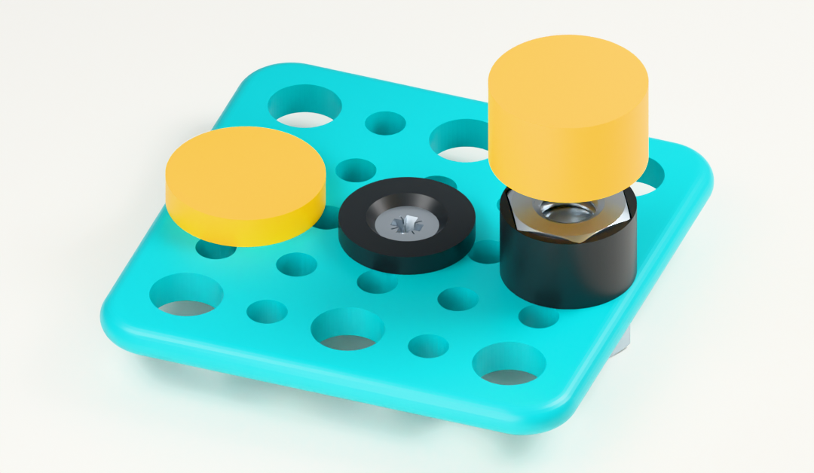
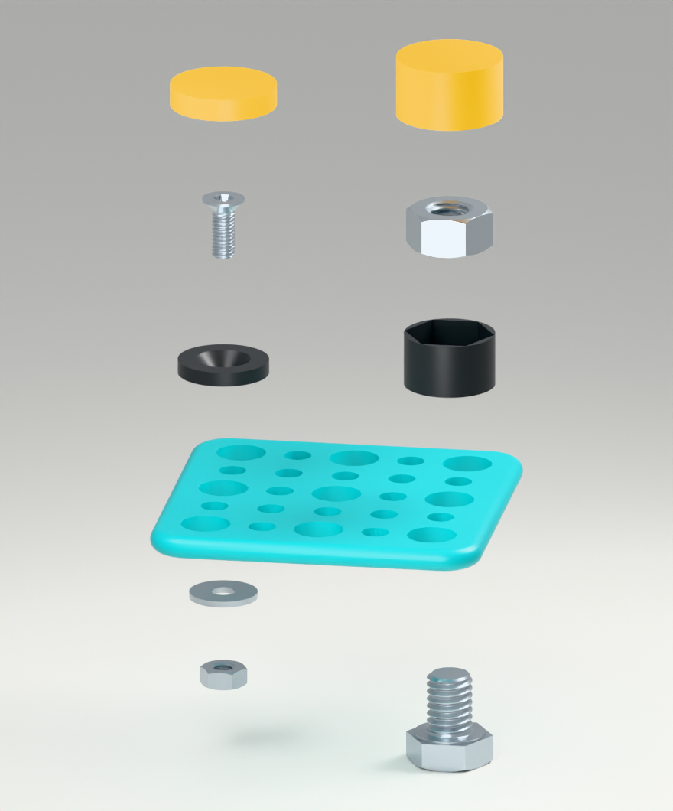
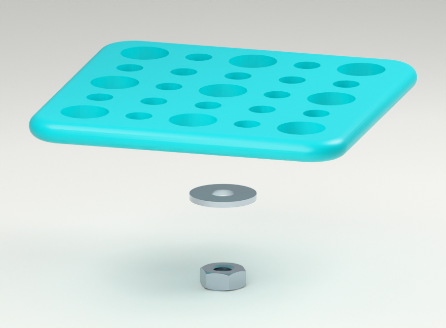
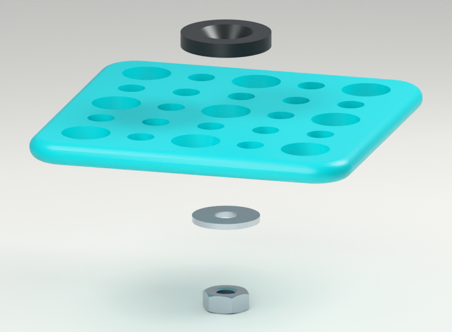
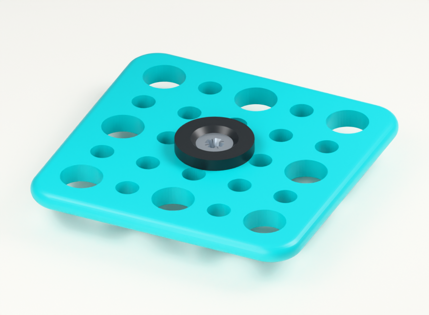
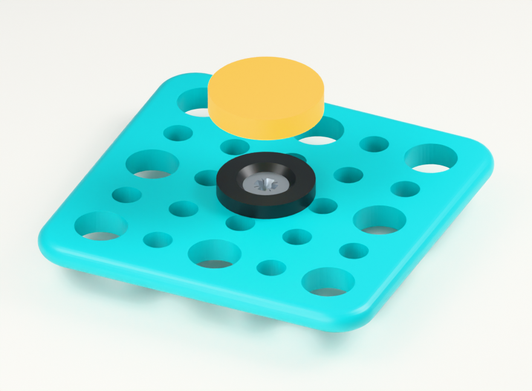
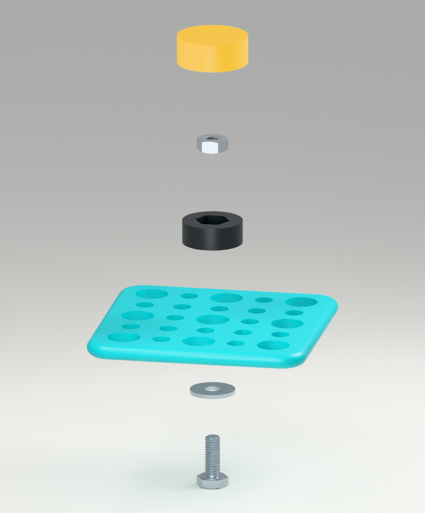
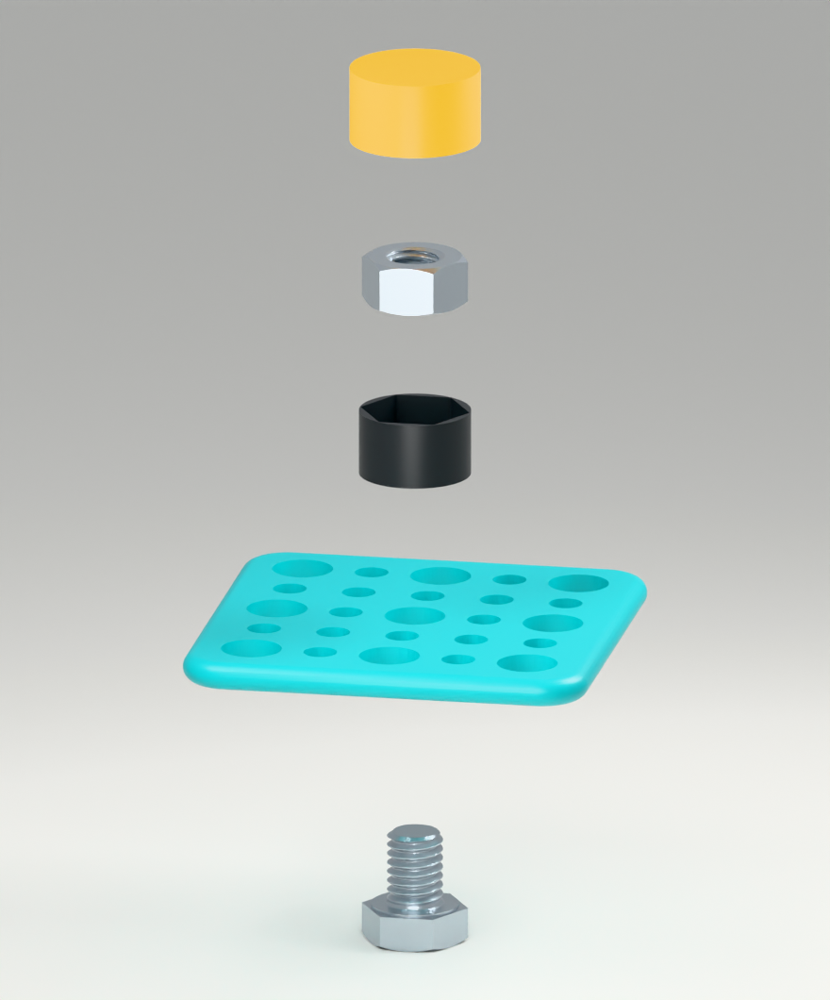
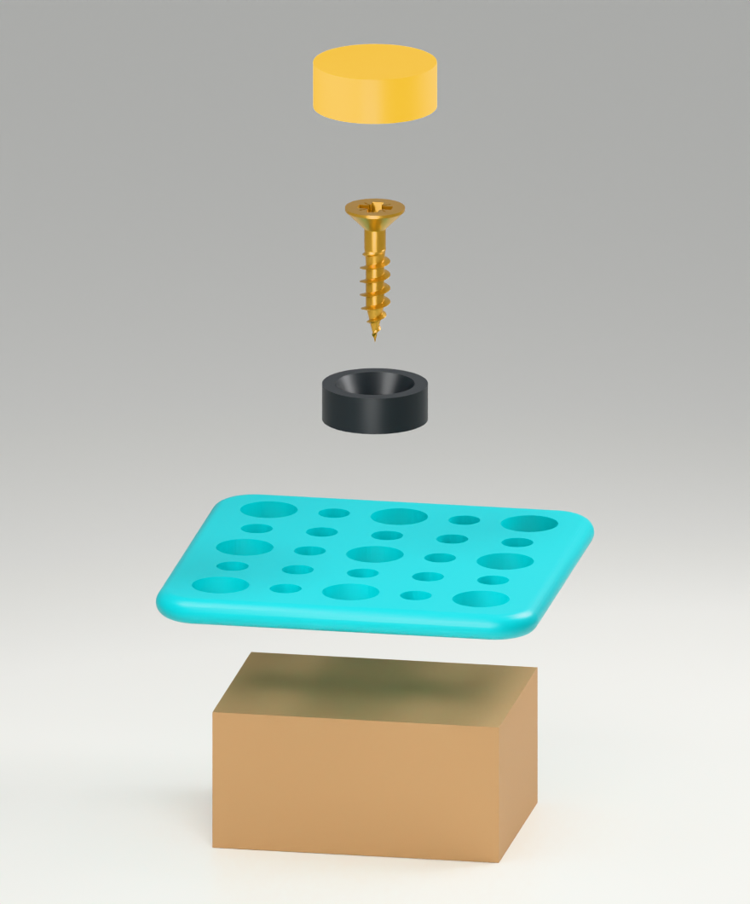

# To flat · basic set

A flat underside bears directly on the mounting surface. Centre the adapter by hand before tightening the fastener.

Left: M3 countersunk screw, wide washer and nut. Right: M6 hex nut and hex-head bolt. The yellow caps fit over the black adapters.

[Open the 40-piece P1S project](working.3mf) · [Assembly booklet (PDF)](assembly/assembly_instructions.pdf) · [Standalone HTML guide](assembly/assembly_instructions.html)

The plate contains five adapters and five caps for each row below. To recolour one piece in Bambu Studio, open **Prepare → Objects**, select its numbered copy and choose a slot in the filament column. Diameters are 12 mm for the flange and 14 mm for the cap. Adapter height includes any locating sleeve. Cap height includes the 1 mm roof.

| Fastener | Adapter height | Cap height |
| --- | ---: | ---: |
| M3 countersunk screw | [1.9 mm](../../parts/oobb_part_cosmetic_adapter_m3_countersunk_12_mm_diameter_1_9_mm_depth_to_flat/) | [2.9 mm](../../parts/oobb_part_cosmetic_cap_m3_countersunk_14_mm_diameter_2_9_mm_depth_to_flat/) |
| M3 hex nut | [4.5 mm](../../parts/oobb_part_cosmetic_adapter_m3_nut_12_mm_diameter_4_5_mm_depth_to_flat/) | [5.5 mm](../../parts/oobb_part_cosmetic_cap_m3_nut_14_mm_diameter_5_5_mm_depth_to_flat/) |
| M6 hex nut | [7 mm](../../parts/oobb_part_cosmetic_adapter_m6_nut_12_mm_diameter_7_mm_depth_to_flat/) | [8 mm](../../parts/oobb_part_cosmetic_cap_m6_nut_14_mm_diameter_8_mm_depth_to_flat/) |
| 3.5 mm wood screw | [4.2 mm](../../parts/oobb_part_cosmetic_adapter_m3_5_screw_wood_12_mm_diameter_4_2_mm_depth_to_flat/) | [5.2 mm](../../parts/oobb_part_cosmetic_cap_m3_5_screw_wood_14_mm_diameter_5_2_mm_depth_to_flat/) |

## Assembly

The worked example uses an M3 × 8 mm countersunk screw, M3 nut and 9 mm OD washer on a 3 mm OOBB plate.

**1. Back the clearance hole.** Hold the 9 mm outside-diameter M3 washer and M3 nut under the centre hole of the plate.

**2. Locate the adapter.** Centre the adapter over the clearance hole with the conical seat facing up.

**3. Seat the screw.** Pass the M3 x 8 mm countersunk screw through the adapter and washer. Engage the nut and tighten until the head is recessed.

**4. Fit the cap.** Press the open end of the matching cap over the flange until its rim meets the plate.

## Other fasteners

### M3 hex nut

Align the nut flats with the pocket and press the nut onto its floor. Thread an M3 screw in from the reverse side. The illustrated 8 mm screw uses a 9 mm OD, 0.8 mm thick washer under its head on a 3 mm plate.

### M6 hex nut

Seat the hex nut in the pocket and thread an M6 screw in from below. The pocket is 5 mm deep. The 5.2 mm example nut stands 0.2 mm proud and lifts the cap by that amount.

### 3.5 mm wood screw

Align the plate with a pilot hole in the timber. Drive the wood screw through the adapter into the timber until its head seats below the rim. Select the screw length for your backing.

## Print and fit

Print the supplied orientations. The cap prints closed face down. Where an adapter has a sleeve, the flange prints against the bed and the sleeve points up.

The cap cavity tapers from 12.15 mm at the mouth to 11.85 mm below the roof. Try one pair with your filament before printing the whole plate. The M6 nut pocket leaves about 0.09 mm of plastic at its six corners. Inspect these points after printing.

AI-generated CAD images and instructions. Errors possible. Physical fit has not been tested.

[Project catalogue](../../)
