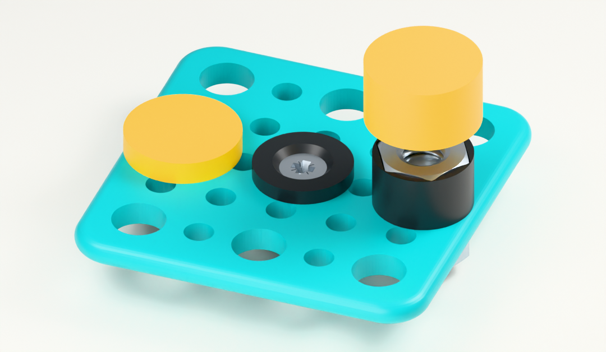
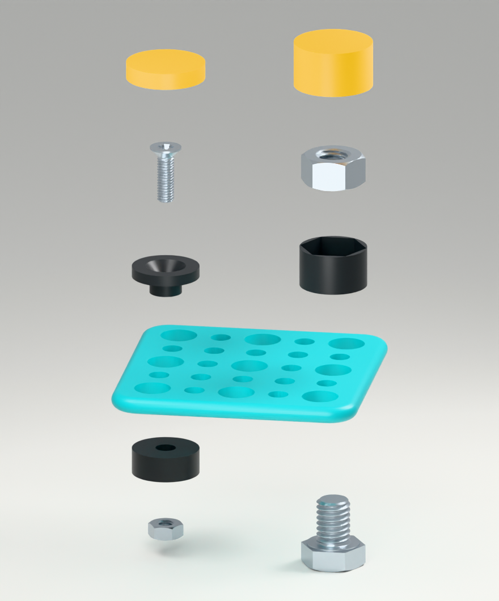
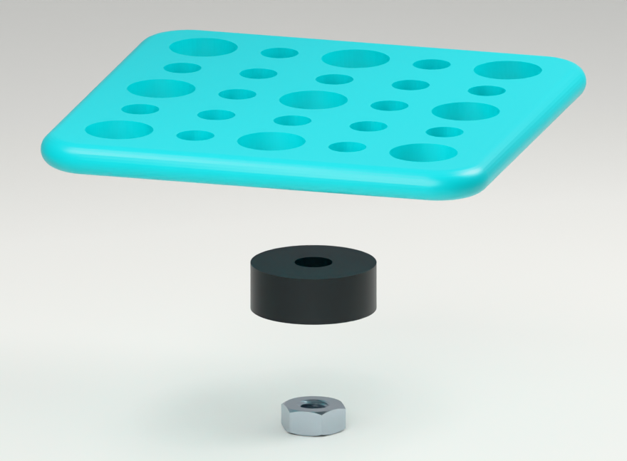
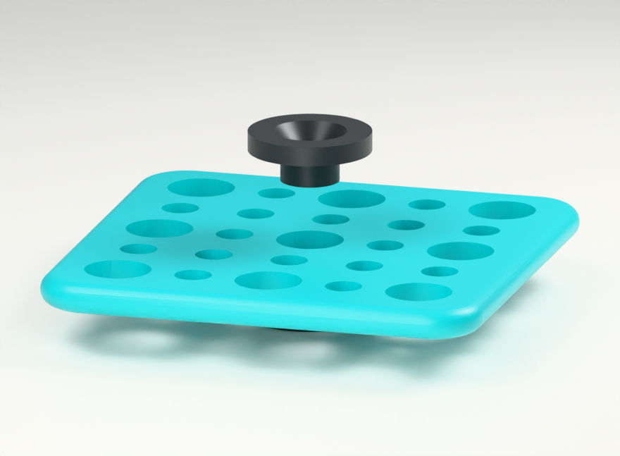
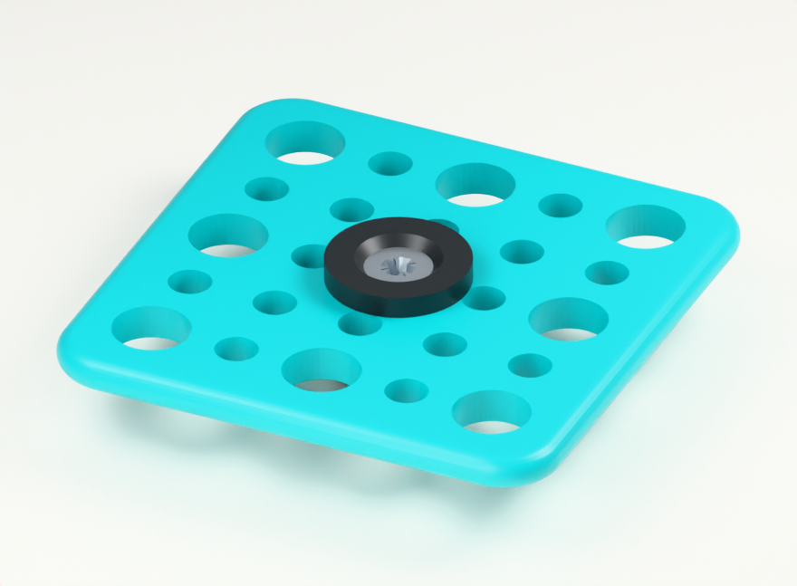
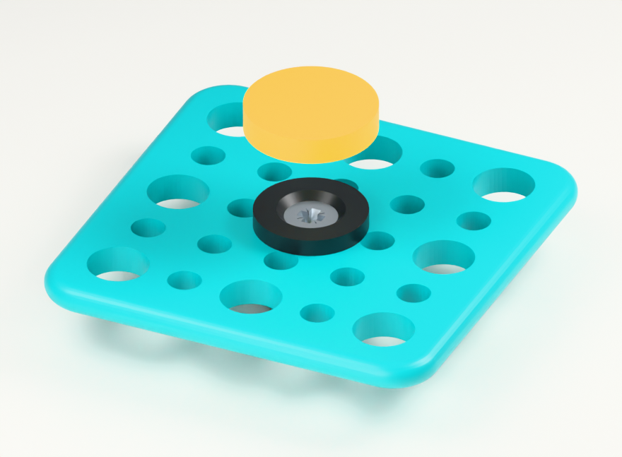
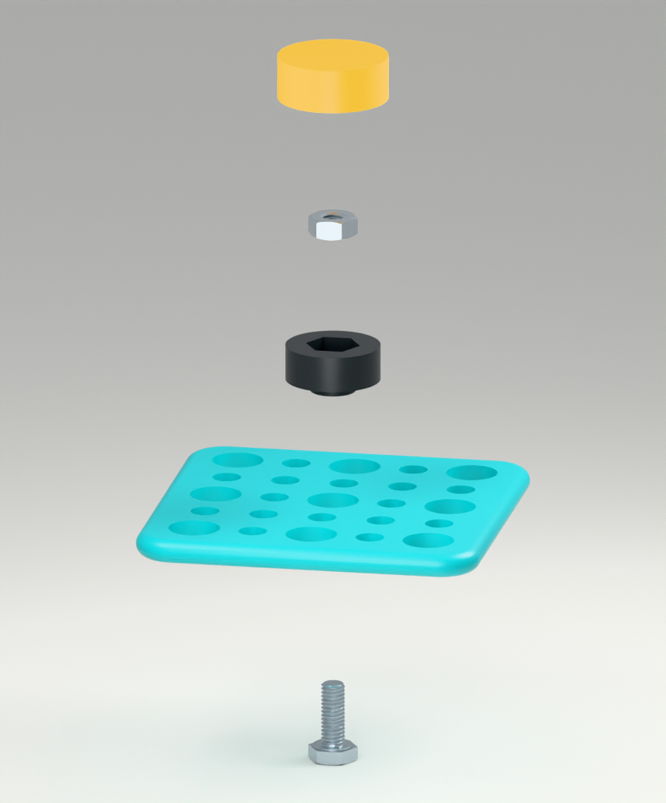
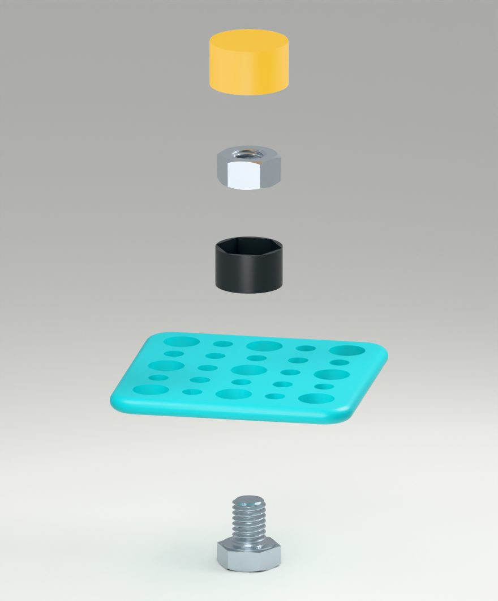
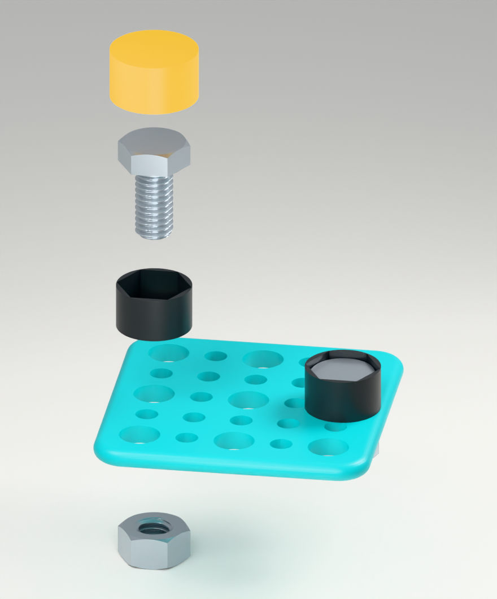
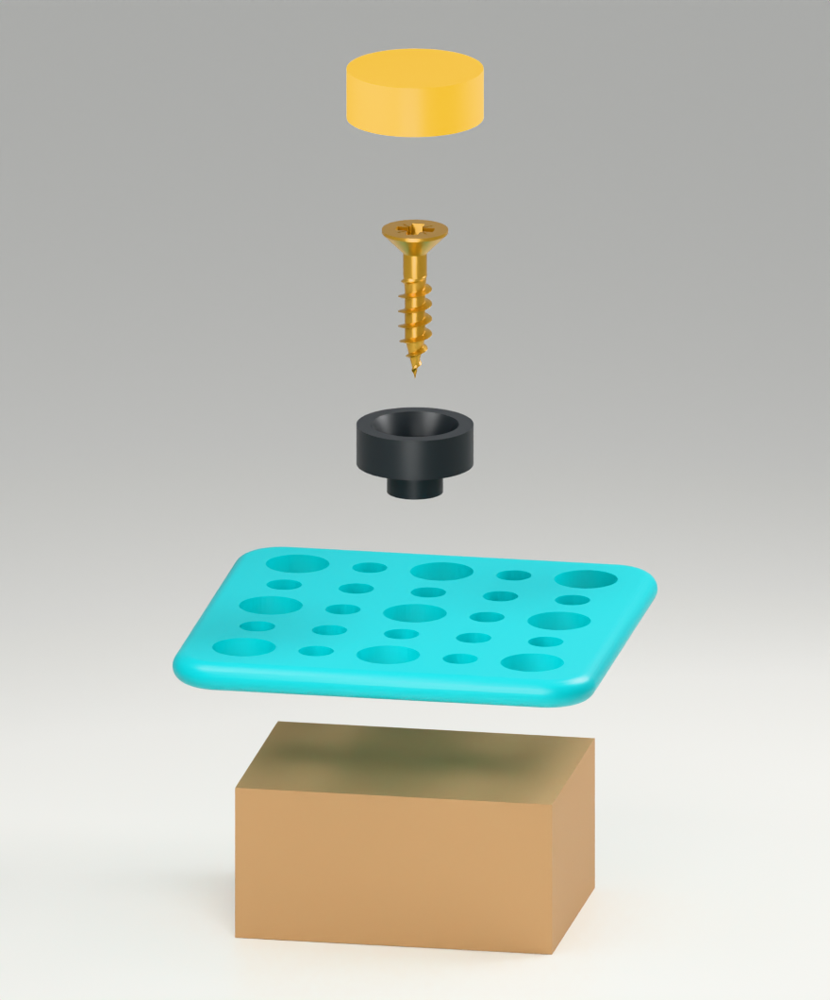

# To M6 · basic set

A 5.75 mm locating sleeve enters an M6 clearance hole. It projects 3 mm on the two screw adapters and 1.5 mm on the M3 nut adapter. The M6 nut adapter has a flat underside because its 6.5 mm bore is wider than the sleeve.

Left: M3 countersunk screw with a second black adapter holding the M3 nut behind the plate. Right: M6 nut seated in its adapter, with the bolt entering from below.

[Open the 40-piece P1S project](working.3mf) · [Assembly booklet (PDF)](assembly/assembly_instructions.pdf) · [Standalone HTML guide](assembly/assembly_instructions.html)

The plate contains five adapters and five caps for each row below. To recolour one piece in Bambu Studio, open **Prepare → Objects**, select its numbered copy and choose a slot in the filament column. Diameters are 12 mm for the flange and 14 mm for the cap. Adapter height includes any locating sleeve. Cap height includes the 1 mm roof.

| Fastener | Adapter height | Cap height |
| --- | ---: | ---: |
| M3 countersunk screw | [4.9 mm](../../parts/oobb_part_cosmetic_adapter_m3_countersunk_12_mm_diameter_4_9_mm_depth_to_m6/) | [2.9 mm](../../parts/oobb_part_cosmetic_cap_m3_countersunk_14_mm_diameter_2_9_mm_depth_to_m6/) |
| M3 hex nut | [6 mm](../../parts/oobb_part_cosmetic_adapter_m3_nut_12_mm_diameter_6_mm_depth_to_m6/) | [5.5 mm](../../parts/oobb_part_cosmetic_cap_m3_nut_14_mm_diameter_5_5_mm_depth_to_m6/) |
| M6 hex nut or hex-head bolt | [7 mm](../../parts/oobb_part_cosmetic_adapter_m6_nut_12_mm_diameter_7_mm_depth_to_m6/) | [8 mm](../../parts/oobb_part_cosmetic_cap_m6_nut_14_mm_diameter_8_mm_depth_to_m6/) |
| 3.5 mm wood screw | [7.2 mm](../../parts/oobb_part_cosmetic_adapter_m3_5_screw_wood_12_mm_diameter_7_2_mm_depth_to_m6/) | [5.2 mm](../../parts/oobb_part_cosmetic_cap_m3_5_screw_wood_14_mm_diameter_5_2_mm_depth_to_m6/) |

## Assembly

The worked example uses an M3 × 10 mm countersunk screw and a nut captured in a flat M3 nut adapter behind a 3 mm plate.

[Flat M3 nut adapter STL](../../parts/oobb_part_cosmetic_adapter_m3_nut_12_mm_diameter_4_5_mm_depth_to_flat/3dpr.stl). Print this extra flat adapter for the back. Two opposed locating sleeves would meet inside the 3 mm plate.

**1. Seat the backing nut.** Seat an M3 nut in a To flat M3 nut adapter. Hold the flat underside against the back of the plate, with the nut pocket facing out.

**2. Locate the adapter.** Lower the 3 mm sleeve into the M6 clearance hole until the flange rests on the plate.

**3. Seat the screw.** Pass the M3 × 10 mm countersunk screw through the front adapter and plate. Thread it into the captured nut and tighten until the head is recessed.

**4. Fit the cap.** Press the open end of the matching cap over the flange until its rim meets the plate.

## Other fasteners

### M3 hex nut

Align the M3 nut with the hex pocket and seat it against the floor. Insert the M3 screw from the other face of the plate and tighten. If you cap the nut side, check the screw tip clears the roof.

### M6 hex nut

Seat the hex nut in the pocket and thread an M6 screw in from below. The pocket is 5 mm deep. The 5.2 mm example nut stands 0.2 mm proud and lifts the cap by that amount.

#### Capturing the bolt head

The same M6 nut adapter also captures an M6 hex-head bolt with a 10 mm head across the flats. Feed the shank through the pocket and plate, align the head flats and seat the head. Tighten an M6 nut on the reverse side and press the cap over the bolt head.

### 3.5 mm wood screw

Align the plate with a pilot hole in the timber. Drive the wood screw through the adapter into the timber until its head seats below the rim. Select the screw length for your backing.

## Print and fit

Print the supplied orientations. The cap prints closed face down. Where an adapter has a sleeve, the flange prints against the bed and the sleeve points up.

The cap cavity tapers from 12.15 mm at the mouth to 11.85 mm below the roof. Try one pair with your filament before printing the whole plate. The M6 nut pocket leaves about 0.09 mm of plastic at its six corners. Inspect these points after printing.

AI-generated CAD images and instructions. Errors possible. Physical fit has not been tested.

[Project catalogue](../../)
