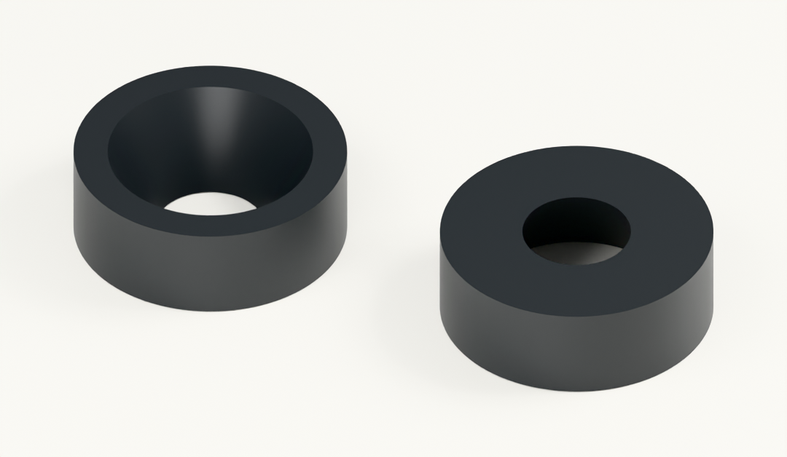
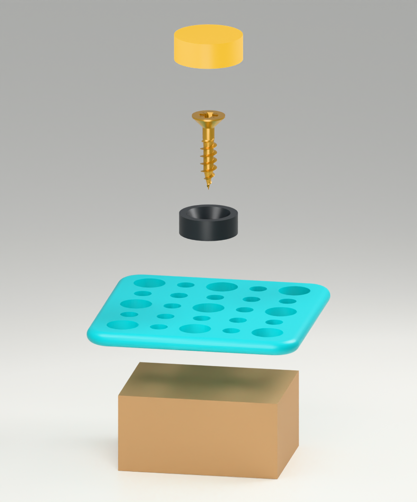

# 3.5 mm wood screw adapter · To flat

Outside diameter **12 mm** · overall height **4.2 mm**.

[Print this adapter](3dpr.stl) · [Matching cap](../oobb_part_cosmetic_cap_m3_5_screw_wood_14_mm_diameter_5_2_mm_depth_to_flat/) · [40-piece print set](../../output/basic_set_to_flat/working.3mf)

## Assembly

1. Choose the adapter and cap for the same fastener. Check the screw length against the plate, adapter and available thread or backing.
2. Centre the flat underside of the adapter over the hole, with the fastener pocket facing out.
3. Align the plate with a pilot hole in the timber. Drive the wood screw through the adapter into the timber until its head seats below the rim. Select the screw length for your backing.
4. Check that the fastener clears the underside of the cap roof. Press the cap over the flange with its open end toward the plate.

The black flange rests on the teal plate. The yellow cap covers the exposed flange. The same fastener takes the same cap in either mounting version.

[Hardware record](https://github.com/oomlout/oomp_hardware_screw_version_5/tree/main/parts/hardware_screw_wood_pozidriv_net_coat_yellow_plated_m3_5_diameter_16_mm_length_screwtite_419fy) · [Set guide](../../output/basic_set_to_flat/) · [Canonical part](./)

AI-generated CAD images and instructions. Errors possible. Physical fit has not been tested.

OOMP ID `oobb_part_cosmetic_adapter_m3_5_screw_wood_12_mm_diameter_4_2_mm_depth_to_flat`
